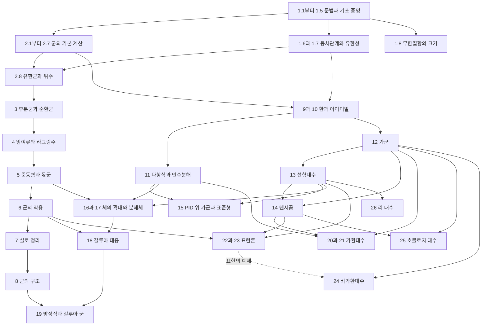

# 현대대수학 교재 구성과 집필 계획

이 교재는 정의에서 출발하여 군, 환, 가군, 체와 갈루아 이론을 익히고 가환대수와 유한군의 표현론까지 나아가는 한국어 현대대수학 교재이다. 수학적 설명과 직접 작성한 Lean 정의·증명을 함께 제시한다. 이후의 확장 과정에는 비가환대수, 호몰로지 대수와 리 대수의 입문을 둔다.

기본 과정은 아래 1장부터 23장까지로 잡는다. 24장부터 26장은 기본 과정에서 필요한 내용을 골라 이어 읽는 확장 과정이다. 장 번호와 분량은 집필 과정에서 조정하되 선수 관계와 각 장의 도달점은 유지한다. 현재 본문에 수록된 것은 1장과 2장이며, 다음 집필 대상은 3장 「부분군과 순환군」이다.

## 현재 본문과 다음 단계

| 현재 장 | 다룬 내용 | 다음 단계에서 사용할 결과 |
|---|---|---|
| 1 준비 | Lean 문법, 증명의 구성과 사용, 집합과 함수, 정수와 동치관계, 몫타입, 기수와 유한성 | 함수 합성과 역함수, 부분타입, 귀납법, 원소별 비교, 몫의 대표원에 무관한 정의 |
| 2 연산과 군 | 이항연산, 군의 정의와 유일성·소거법칙, 역원과 거듭제곱, 두 원소 군·군의 곱·순열군, 계산 자동화 | `Group A`, 역원과 지수 법칙, `productGroup`, `permutationGroup`, `group_calc G` |

2.2의 연습문제에 나오는 역원의 역원과 오른쪽 소거법칙은 이후에 사용할 수 있도록 2.3에서 본문 정리로 증명한다. 독자가 풀지 않은 연습문제의 `sorry`를 이후 정리의 근거로 사용하지 않는다.

## 준비 장과 군론의 읽기 순서

준비 장의 1.1~1.5는 문법, 증명, 집합, 함수, 자연수와 정수이다.
1.6은 동치관계와 몫집합, 1.7은 집합의 크기와 유한성, 1.8은 무한집합의 크기이다.
정의부터 읽는 경로는 1장 전체를 마치고 2장으로 진행한다.
군론을 먼저 읽는 경로는 1.1~1.5에서 2.1~2.7로 진행하고,
2.8의 위수 앞에서 1.6~1.7로 돌아온다. 1.8은 기본 군론의 선수 내용이 아니다.

2장은 이항연산, 군의 정의와 기본 성질, 역원과 곱의 계산, 거듭제곱,
군의 곱, 순열군, 군 계산의 자동화, 유한군과 위수의 여덟 절로 구성한다.
두 원소 군은 2.2에서 정의하고 2.4에서 거듭제곱, 2.8에서 원소 수를 다룬다.

## 군론

| 장 | 주제 | 핵심 내용과 도달점 |
|---|---|---|
| 2 | 연산과 군 | 이항연산과 군의 정의, 기본 법칙, 역원과 자연수·정수 지수, 두 원소 군, 군의 곱, 순열군과 작은 비가환 예제 |
| 3 | 부분군과 순환군 | 부분군 판정, 교집합과 생성된 부분군, 원소의 위수, 순환군의 부분군과 분류 |
| 4 | 잉여류와 라그랑주 정리 | 좌·우잉여류, 분할, 지수, 유한군의 위수와 나누어떨어짐, 소수 위수 군 |
| 5 | 준동형과 몫군 | 준동형과 동형, 핵과 상, 정규부분군, 몫의 연산, 세 동형정리와 대응정리, 정수의 나머지류 군 |
| 6 | 군의 작용 | 궤도와 안정자, 작용에 따른 순열 표현, 케일리 정리, 켤레류와 중심, 류방정식, 번사이드의 계수 공식 |
| 7 | 유한군과 실로 정리 | 코시 정리, p군, 실로 부분군의 존재·켤레성·개수, 작은 위수 군의 분석 |
| 8 | 군의 구조 | 군의 곱과 반직접곱, 정규열과 조성열, 조르당–횔더 정리, 가해군과 멱영군, 자유군과 생성원·관계식 |

2.4에서 하나의 원소를 반복해서 연산하는 방법을 익힌 뒤 3장에서 그 원소가 만드는 부분군을 다룬다. 4장에서는 부분군이 군 전체를 어떻게 나누는지 세고, 5장에서는 그 부류들에 연산을 내려 새로운 군을 만든다. 군의 작용은 실로 정리의 증명과 이후 갈루아 군·표현의 예제로 이어진다.

이면체군은 2장의 순열 예제에서 삼각형의 구체적인 순열을 통해 처음 접하고, 6장에서 다각형의 대칭 작용을 살펴본 뒤 8장에서 반직접곱과 관계식으로 다시 설명한다. 순환군의 동형에 의한 분류는 5장의 동형 개념을 익힌 뒤 완결한다. 유한생성 아벨군의 구조정리는 15장의 가군 이론에서 증명하고 군론의 예제로 되돌아온다.

## 환론과 다항식

| 장 | 주제 | 핵심 내용과 도달점 |
|---|---|---|
| 9 | 환과 체의 기초 | 환·가환환·정역·나눗셈환·체, 부분환, 단원과 영인자, 행렬환과 함수환의 예 |
| 10 | 아이디얼과 몫환 | 환 준동형, 핵과 상, 아이디얼, 몫환과 동형정리, 소·극대 아이디얼, 중국인의 나머지 정리 |
| 11 | 다항식과 인수분해 | 다항식의 계수와 차수, 나눗셈 알고리즘, 유클리드 정역·PID·UFD, 가우스 보조정리, 기약성 판정과 근의 개수 |

환은 항등원을 갖는 것으로 정하고 환 준동형은 항등원을 보존하도록 한다. 비가환환을 먼저 포함한 뒤 가환성이 필요한 정리에 그 가정을 명시한다. 영환을 허용하는 관례와 체에서 `0 ≠ 1`을 요구하는 조건은 정의에서 분명히 한다.

정수환과 다항식환을 계속 비교하며 아이디얼, 나눗셈과 인수분해가 같은 구조를 어떻게 드러내는지 설명한다. 다항식의 근의 개수는 유한체의 곱셈군과 체의 확대에서 다시 사용한다.

## 가군과 선형대수

| 장 | 주제 | 핵심 내용과 도달점 |
|---|---|---|
| 12 | 가군 | 왼쪽 가군, 부분가군, 준동형과 몫가군, 생성과 관계식, 자유가군, 가군의 직접합과 곱, 동형정리 |
| 13 | 벡터공간과 선형사상 | 유한 기저와 차원, 행렬, 차원정리, 쌍대공간, 행렬식, 고유값과 특성다항식, 케일리–해밀턴 정리 |
| 14 | 텐서곱과 보편 성질 | 쌍선형사상, 텐서곱의 구성과 보편 성질, Hom과 텐서, 계수환의 확대, 대칭곱과 외대수 |
| 15 | PID 위의 유한생성 가군 | 자유부분과 꼬임부분, 구조정리와 불변인자, 스미스 표준형, 유한생성 아벨군의 분류, 유리 표준형과 조르당 표준형 |

벡터공간은 체 위의 가군으로 정의한다. 선형대수를 이미 배웠다고 가정하여 정리를 건너뛰지 않으며 이후 체의 확대 차수를 다룰 만큼의 기저·차원·선형사상을 본문에서 증명한다. 임의의 벡터공간의 기저 존재에 관한 선택공리의 논증은 관련 Advanced 절에 두고 유한생성 공간의 기본 논증과 구별한다.

13장의 행렬식은 순열을 통한 정의에서 출발한다. 외대수를 통한 해석은 14장에서 연결한다. 15장의 유리 표준형은 다항식환 위 가군으로, 조르당 표준형은 특성다항식이 일차식으로 분해되는 경우로 설명한다. 비가환환 위의 텐서곱에는 오른쪽 가군과 왼쪽 가군이 필요하므로 이 구분을 14장에서 도입한다.

## 체론과 갈루아 이론

| 장 | 주제 | 핵심 내용과 도달점 |
|---|---|---|
| 16 | 체의 확대 | 소체와 표수, 확대와 매장, 차수와 탑 법칙, 대수적·초월적 원소, 최소다항식과 단순 확대 |
| 17 | 분해체와 유한체 | 분해체의 존재와 유일성, 분리성과 비분리성, 정규 확대, 완전체, 유한체의 존재·유일성과 프로베니우스 사상 |
| 18 | 갈루아 대응 | 체의 자기동형, 고정체, 아르틴 정리, 유한 갈루아 확대의 기본정리와 중간체의 계산 |
| 19 | 방정식과 갈루아 군 | 원분체, 작도 가능성, 근호 확대, 가해군과 근호에 의한 풀이, 저차 다항식과 풀리지 않는 다항식의 예 |

16장부터는 환 준동형과 선형대수를 함께 사용한다. 확대를 포함 관계만으로 설명하지 않고 기초체의 매장이 주어진 구조로 다루어 같은 체의 서로 다른 매장을 구별한다. 17장의 유한체는 존재·유일성·곱셈군의 순환성·부분체를 여러 절에 나누어 증명한다. 부분체의 갈루아 대응을 통한 재해석은 18장에서 다룬다.

대수적 폐포의 일반적인 존재 증명은 17장의 Advanced 하위 절로 둔다. 기본 갈루아 이론은 필요한 다항식의 분해체를 구성하여 진행한다. 이후 대수적으로 닫힌 체 위의 정리에서는 그 성질을 가정에 적으며 Advanced 절의 구현을 호출하지 않는다.

## 가환대수와 표현론

| 장 | 주제 | 핵심 내용과 도달점 |
|---|---|---|
| 20 | 국소화와 뇌터 환 | 곱셈적 집합과 분수, 환·가군의 국소화, 사슬조건, 힐베르트 기저정리, 나카야마 보조정리, 일차분해 |
| 21 | 정수적 확대와 차원 | 정수적 원소와 정수적 폐포, lying over와 going up, 뇌터 정규화, 크룰 차원, 영점정리와 아핀 대수집합, 데데킨트 정역의 입문 |
| 22 | 유한군의 표현 | 표현과 군대수, 부분표현과 기약표현, 마슈케 정리, 슈어 보조정리, 직접합 분해 |
| 23 | 지표와 유도표현 | 대각합과 지표, 직교관계, 정규표현, 지표표, 제한과 유도, 프로베니우스 상호법칙, 구체적인 군의 지표 계산 |

20·21장은 환론과 가군 이론에서, 22·23장은 군의 작용과 선형대수에서 이어지는 두 갈래이다. 표현론을 읽기 위해 가환대수 두 장을 먼저 마칠 필요는 없다. 마슈케 정리에는 기초체의 표수가 군의 위수를 나누지 않는 조건을 두며, 지표의 기본 결과에는 대수적으로 닫힌 표수 0의 기초체 등 해당 정리에 필요한 가정을 명시한다.

구체적인 복소 표현의 수학적 예제와 일반 기초체 위의 Lean 정리를 함께 사용한다. 복소수의 해석학적 구성을 표현론의 선수 지식으로 추가하지 않는다.

## 확장 과정

| 장 | 주제 | 선수 내용과 도달점 |
|---|---|---|
| 24 | 비가환대수 | 환·가군·표현의 기본 이론에서 출발하여 단순 가군, 근기, 반단순 환과 아르틴–웨더번 정리를 다룬다. 중심 단순 대수와 브라우어 군은 관련 Advanced 절로 이어진다. |
| 25 | 호몰로지 대수 | 가군·텐서곱에서 출발하여 완전열, 사슬복합체, 호몰로지, 사영·단사 가군과 분해, Ext와 Tor를 정의하고 함자성과 기본 완전열을 증명한다. |
| 26 | 리 대수 | 선형대수와 대수의 표현에서 출발하여 괄호와 야코비 항등식, 행렬 리 대수, 아이디얼과 표현, 가해·멱영 리 대수의 기본 성질을 다룬다. 구조와 분류의 심화는 Advanced 절로 둔다. |

범주와 함자의 언어는 보편 성질과 완전열을 설명할 때 필요한 만큼 도입한다. 일반 범주론을 군론 앞의 준비 장으로 옮기지 않는다. 스킴, 대수적 수론의 전개, 리 군의 미분기하와 유도범주는 이 과정 다음의 전문 분야로 연결한다.

## 선수 관계와 읽기 경로

실선은 주요 선수 관계를, 점선은 예제의 연결을 나타낸다. 기본 독서 순서는 장 번호를 따르되 군론을 더 진행하거나 환론·가군으로 먼저 넘어가는 두 경로를 둘 수 있다.

학부의 기본 과정은 1장부터 19장까지에서 한 차례 마무리한다. 이어서 20장부터 23장까지 가환대수와 표현론을 익히고 목적에 따라 확장 과정을 선택한다.

## Lean 정의와 구현

새로운 수학적 정의는 교재에서 작성하고 Lean의 기본 논리, 자연수와 정수, 유한 번호, 리스트와 몫타입을 기반으로 사용한다. 수학적 설명과 구현에서 서로 다른 표현을 사용한다면 그 둘을 연결하는 정리를 먼저 둔다.

- `Group A`, `Ring R`, `Module R M`처럼 원소 타입과 구조를 구별한다. 같은 타입 위의 서로 다른 구조를 함께 사용할 수 있게 한다.
- 부분군·아이디얼·부분가군은 원래 타입 위의 집합과 닫힘 조건을 묶는다. 해당 집합의 원소 타입은 `Elem`으로 명시하며 집합을 타입으로 바꾸는 암시적 변환은 추가하지 않는다.
- 준동형에는 함수와 보존 법칙을 함께 담는다. 항등 준동형, 합성, 핵과 상 및 외연성 정리를 먼저 마련하고 이후 분야에서도 같은 관례를 따른다.
- 몫의 연산은 대표원에 무관함을 증명한 뒤 정의한다. 새로운 구조의 `ext`와 `indisc`은 실제로 증명한 비교 원리에 연결한다.
- 유한합·유한 지지·계수·차수·행렬곱의 보조 구현은 그 대상이 처음 필요한 장에서 준비한다. 다항식의 유한 지지 조건을 정의에 포함한다.
- 일반 타입 위의 군·환·사상에는 `Type u`를 지원하는 방향으로 정의를 확장한다. 기존 `Cardinal`의 우주 수준과 그 대상 범위는 별도로 점검하며 이 작업을 다음 장의 예제와 한꺼번에 섞지 않는다.

## 자동화의 도입

| 시점 | 자동화의 범위 | 직접 남길 논증 |
|---|---|---|
| 준비 장의 정수 계산 뒤 | 기존 `arith`의 자연수·정수 산술 | 수학적 경우 구분, 증인의 선택, 귀납법 |
| 군의 기본 법칙과 거듭제곱 법칙 뒤 | `group_calc G`로 군의 곱·역원·거듭제곱 계산 | 부분군의 구성, 준동형의 보존 법칙, 군의 작용 |
| 몫군의 구성 뒤 | 몫의 연산을 대표원의 계산과 연결 | 대표원에 무관함을 보이는 증명 |
| 환과 다항식의 기본 성질 뒤 | 환의 식 정리와 계수 비교 | 아이디얼의 원소 조건, 기약성, 인수의 선택 |
| 선형대수의 기본 성질 뒤 | 선형결합과 작은 행렬의 계산 | 기저의 선택, 일차독립성과 생성의 논증 |

`group_calc G`는 2.7에서 소개한다. 위수는 2.8에서 집합의 크기를 군에 적용하여 정의한다. 그 앞에서 직접 증명한 곱·역원·거듭제곱 법칙으로 계산하며 군 구조 `G`를 지정한다. 군의 법칙은 산술과 다른 규칙 모음에 두고 지수·유한 번호의 계산이 필요할 때 `arith`를 호출한다. `suffices h : G by ...`에서도 연결 증명에 해당 분야의 전술을 명시한다.

## 예제와 연습문제

각 절은 필요성의 설명, 정의, 작은 계산 예제, 기본 정리와 증명, 반례와 비교, 연습문제의 순서로 구성한다. 보기는 뒤에서 다시 사용하는 이름 붙은 결과로 남긴다. 새 전술은 본문에서 설명한 뒤 연습문제에 사용한다.

하나의 예제를 여러 분야에서 다시 살펴본다. 정수와 그 부분군은 아이디얼과 몫환으로, 세 문자 위의 순열군은 군의 작용·갈루아 군·지표표로, `Z/nZ`는 군·환·가군·중국인의 나머지 정리로 이어진다. 행렬은 선형사상·가군의 구조·표현·리 괄호에서 다시 사용한다.

Advanced는 관련 장의 하위 절에 둔다. 기본 이론의 핵심 정리는 구현의 길이만으로 Advanced로 분류하지 않으며 기본 본문이 Advanced의 정리나 연습문제 풀이에 의존하지 않게 한다.

## 다음 장의 준비와 완성 조건

준비 장과 군론의 선수관계, 다음 장의 구성은 [부분군과 순환군 집필 준비](planning/NextChapter.md)에 정리했다. [구현 확인 코드](planning/GroupExamples.lean)는 집필 전에 작성한 준비 자료이며, 독자용 설명과 완성된 증명은 2장 본문에 수록한다. 다음 집필 대상은 3장 「부분군과 순환군」이다.

새 절을 본문에 넣은 뒤에는 문서 생성, 추출 코드 검사와 연습문제 원본의 갱신을 수행한다. 개인 풀이 `Exercises/`는 보존한다. PDF는 명시적인 요청이 있을 때 생성한다.

## 범위의 참고 기준

군론, 환과 가군, 체와 갈루아 이론, 유한군의 표현을 포함하는 범위는 [Harvard의 대수학 시험 범위](https://www.math.harvard.edu/graduate/study-the-qualifying-exam/the-qualifying-exam-syllabus/)를 참고한다. 환·아이디얼·몫, 인수분해, 가군과 텐서곱에서 이후 분야로 나아가는 준비 내용은 [Cambridge의 대수학 준비 안내](https://www.maths.cam.ac.uk/postgrad/part-iii/prospective/preparation/resources/algebra)와 비교한다. 장의 배열과 예제·설명·증명의 구성은 이 교재의 목적에 맞추어 정한다.
